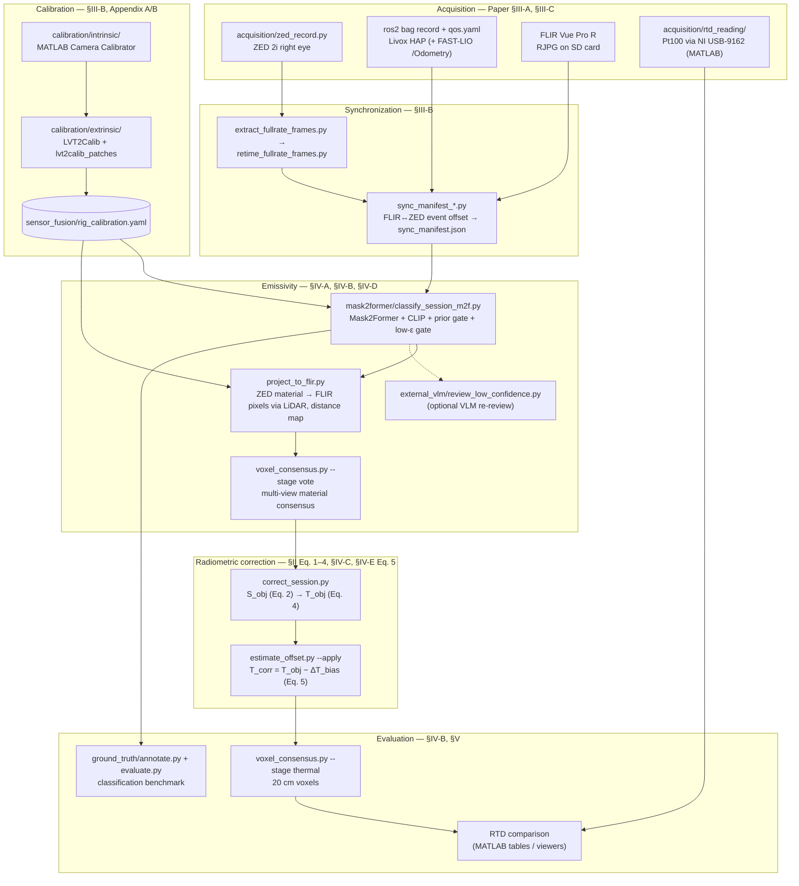

# Per-Pixel Emissivity Assignment and Radiometric Temperature Correction

Code accompanying the paper *"Per-Pixel Emissivity Assignment and Radiometric
Temperature Correction"* (L. Widmann, S. Chiodini).

A radiometric thermal camera reports an *apparent* temperature that assumes a
black body seen through a perfectly transparent atmosphere. This repository
replaces that single global assumption with a **per-pixel** one. Each region of
an RGB frame is segmented with Mask2Former and given a material by CLIP,
restricted by an object-class prior and a low-emissivity gate. A vision-language
model can optionally re-review the low-confidence regions. The material's
tabulated emissivity is then carried onto the thermal image **through the LiDAR
point cloud**, which also gives each pixel its own camera-to-surface distance.
Every pixel is corrected for reflected and atmospheric radiation (emissivity,
transmittance, reflected temperature ≈ air temperature), and a per-session FLIR
sensor bias is removed. The result is checked against a contact Pt100 RTD on
three surfaces: painted metal, glass and bare aluminium.

**Hardware**: AgileX UGV carrying a Livox HAP LiDAR, a ZED 2i stereo camera
(right eye, 1920×1080, 4 mm lens) and a FLIR Vue Pro R radiometric thermal
camera (336×256, 7.5–13.5 µm). LiDAR and ZED run on an onboard Intel NUC. The
FLIR records on its own to its SD card. Ground truth comes from a Pt100 RTD
read through an NI USB-9162 by MATLAB.

---

## Pipeline



| Stage | Paper | Code |
|---|---|---|
| Radiometric model, Eq. 1 (S_tot), Eq. 2 (S_obj), Eq. 3 (S(T)), Eq. 4 (T_obj) | §II | `radiometric_correction/radiometric/` (see the [model mismatch](#known-differences-between-code-and-paper)) |
| Sensing platform | §III-A | `acquisition/` |
| Intrinsic / extrinsic calibration, time sync | §III-B, Appendix A, B | `calibration/`, `synchronization/`, `sensor_fusion/` |
| RTD reference measurement | §III-C | `acquisition/rtd_reading/` |
| Segmentation, classification, prior gate, low-ε gate | §IV-A | `emissivity/mask2former/` (SAM alternative: `emissivity/classify_session.py`) |
| Classification benchmark (224 regions) | §IV-B | `emissivity/ground_truth/` |
| Emissivity transfer via LiDAR, per-pixel correction | §IV-C | `emissivity/project_to_flir.py`, `radiometric_correction/correct_session.py` |
| VLM re-review of low-confidence regions | §IV-D | `emissivity/mask2former/external_vlm/` |
| FLIR bias, Eq. 5 | §IV-E | `radiometric_correction/estimate_offset.py` |
| Validation sessions, 20 cm voxels, RTD comparison | §V | `emissivity/voxel_consensus.py`, `radiometric_correction/matlab/` |

---

## Repository layout

```
acquisition/                 zed_record.py, extract_fullrate_frames.py, qos.yaml
  rtd_reading/               Pt100 / NI USB-9162 MATLAB scripts
calibration/
  intrinsic/                 capture_zed_right.py, MATLAB scripts, OpenCV-format YAMLs for LVT2Calib
  extrinsic/
    conversion/              convert_livox_bag.py, rotate_flir_poses.py
    record_check/            detect_board_poses.py, zed_pose_check.py, find_board_limits.py, lidar_*_check.py
    session_split/           split_zed_poses.py, split_flir_poses.py, pick_hole_patch.py, patch_hole_pose.py
    zed_fill/                fill_board_holes.py
    board_generation/        generate_board_template.py, TragetHoles.STEP
    validation/              FlirLidarZedViewer_calib2.m
    lvt2calib_patches/       files to copy over an upstream LVT2Calib clone (+ 2 catkin packages)
synchronization/             sync_manifest_interpolation.py, sync_manifest_neighbour.py, retime_fullrate_frames.py
sensor_fusion/               rig_calibration.yaml (+ loader), projection.py, livox_odometry_loader.py
emissivity/                  classify_session.py (SAM alternative), project_to_flir.py, voxel_consensus.py,
                             prepare_voxel_comparison.py, emissivity_table.csv, emissivity/ (package)
  mask2former/               classify_session_m2f.py, m2f_materials/, ade_material_prior.csv
    external_vlm/            review_low_confidence.py
  ground_truth/              annotate.py, evaluate.py, ground_truth_*.csv, eval_frames.txt
radiometric_correction/      correct_session.py, estimate_offset.py, main.py, ThermalData.py, radiometric/
  matlab/                    ShowTemperatureCorrection.m, VoxelCorrectionTable.m, ViewThermalPLY.m
docs/                        CHANGES_FROM_THESIS.md (provenance and edit log)
```

Every folder has its own README with inputs, outputs, flags and an example.

---

## Installation

Python **3.13** (tested with 3.13.14). There are two host environments, kept
separate on purpose. The heavy one carries torch and the HF checkpoints. The
light one runs everything that only reads bags, `.npy` maps and JSON.

| Env | File | Used by |
|---|---|---|
| **heavy** (`C:\venvs\emissivity` in the original setup) | `requirements-heavy.txt` | `emissivity/classify_session.py`, `emissivity/mask2former/`, `external_vlm/` |
| **light** (`C:\venvs\sensorfusion`) | `requirements-light.txt` | `synchronization/`, `sensor_fusion/`, `project_to_flir.py`, `voxel_consensus.py`, `prepare_voxel_comparison.py`, `radiometric_correction/`, `ground_truth/`, `calibration/extrinsic/` |
| **VLM** (add to heavy or light) | `emissivity/mask2former/external_vlm/requirements.txt` | `review_low_confidence.py` |
| **rover** (Ubuntu, onboard NUC) | `acquisition/requirements-rover.txt`, `calibration/intrinsic/requirements-rover.txt` | `zed_record.py`, `capture_zed_right.py` |
| optional, Python **3.12** | see `calibration/extrinsic/requirements.txt` | `record_check/lidar_hole_check.py` (open3d 0.19.0 has no 3.13 wheel) |

Windows PowerShell:

```powershell
# Keep the venvs at a short path: torch's install exceeds the 260-char path limit otherwise.
py -3.13 -m venv C:\venvs\emissivity
C:\venvs\emissivity\Scripts\python.exe -m pip install torch==2.13.0 torchvision==0.28.0 --index-url https://download.pytorch.org/whl/cpu
C:\venvs\emissivity\Scripts\python.exe -m pip install -r requirements-heavy.txt
C:\venvs\emissivity\Scripts\python.exe -m pip install -r emissivity\mask2former\external_vlm\requirements.txt

py -3.13 -m venv C:\venvs\sensorfusion
C:\venvs\sensorfusion\Scripts\python.exe -m pip install -r requirements-light.txt
```

Rover (Ubuntu):

```bash
python3 -m venv .venv && source .venv/bin/activate
pip install -r acquisition/requirements-rover.txt -r calibration/intrinsic/requirements-rover.txt
# For zed_record.py --backend sdk: install the ZED SDK, then run its get_python_api.py (installs pyzed).
```

### Non-Python requirements

| What | For |
|---|---|
| **MATLAB** with **Computer Vision Toolbox** (Camera Calibrator, `estimateCameraParameters`) | `calibration/intrinsic/*.m` |
| **MATLAB Data Acquisition Toolbox** (+ NI-DAQmx driver for the USB-9162) | `acquisition/rtd_reading/USB9126_Pt100Reading.m` |
| MATLAB + Computer Vision Toolbox (`pcread`/`pcshow`), ROS Toolbox (`ros2bagreader`), [npy-matlab](https://github.com/kwikteam/npy-matlab) (`readNPY`) on the path | `radiometric_correction/matlab/`, `calibration/extrinsic/validation/` (exact toolbox list: TODO, not verified) |
| **Docker Desktop**, **ROS 1 Noetic** image (upstream LVT2Calib Dockerfile), **VcXsrv** (X server for RViz/GUI on Windows) | LVT2Calib extrinsic calibration |
| ROS 2 (Humble) + `livox_ros_driver2` + FAST-LIO on the rover | LiDAR recording and `/Odometry`, `/cloud_registered` |
| **ffmpeg / ffprobe** on PATH | `acquisition/extract_fullrate_frames.py` |
| **Ollama** + `ollama pull moondream` | default (local) engine of the VLM review |
| `exiftool` (inside the container) | only `flir_frame_publisher --image-mode raw` |

Hugging Face checkpoints download on first use into `~/.cache/huggingface`:
`facebook/mask2former-swin-large-ade-semantic` (~850 MB),
`laion/CLIP-ViT-H-14-laion2B-s32B-b79K` (~3.9 GB) and, for the SAM
alternative, `facebook/sam-vit-base`.

---

## Expected data layout

The raw data is **not** in this repository (see [Data availability](#data-availability)).
The ground-truth sessions are organised like this. Folder names are the ones
used for the paper. `Fllir` is spelled that way on disk.

```
GroundTruthFiles/Dati/
  AcquisitionsRTD/                   Pt100 recordings (.mat, data_vect at 2 Hz), one per session
  Lidar/rosbag2_2026_09_11-HH_MM_SS/ ROS 2 bag: metadata.yaml + *_0.db3
                                     topics /cloud_registered /Odometry /livox/lidar /livox/imu
  Fllir/session_A*_rot180/           FLIR frames rotated 180°: <stamp>_R.jpg + <stamp>.npy (apparent °C)
  Zed/<YYYYmmdd_HHMMSS>/             zed_record.py session
    metadata.json  session_right.mp4  frames/right_NNNNNN.png
    fullrate/                        every mp4 frame, retimed — the --session-dir of every step below
      metadata.json  metadata.uniform.json  flir_zed_offset.json  sync_manifest.json
      material_map_m2f/<flir_stem>/      labels.npy, segments.json, overlay.png
      emissivity_map/<flir_stem>/        emissivity.npy, distance.npy, segment_id.npy, sampled_mask.npy,
                                         corrected_temperature.npy, corrected_temperature_debiased.npy,
                                         correction_report.json, stats.json, overlay.png, ...
      material_map_consensus/<flir_stem>/
      offset_report.json
      voxel_map*/thermal_voxels.{csv,ply}
```

| Session | Surface | ZED `--session-dir` | FLIR rot180 | Bag | T_air | RTD |
|---|---|---|---|---|---|---|
| A1 | painted metal door | `Zed/20260911_094055/fullrate` | `Fllir/session_A1_rot180` | `rosbag2_2026_09_11-11_40_48` | 20.5 °C | 22.19 °C |
| A9 | glass window | `Zed/20260911_104224/fullrate` | `Fllir/session_A9_rot180` | `rosbag2_2026_09_11-12_41_38` | 21.0 °C | 22.9 °C |
| A10 | bare aluminium plate | `Zed/20260911_105024/fullrate` | `Fllir/session_A10_rot180` | `rosbag2_2026_09_11-12_50_10` | 21.0 °C | 23.09 °C |

The A9 RTD value is 22.9 °C in `offset_report.json` and in the paper, but 22.95 °C
in the thesis notes. In the thesis repo the A10 FLIR folder was called
`session_125010_rot180`.

The classification benchmark (§IV-B) was annotated on a different session,
`20260730_161223` (thesis corridor survey). That session is **not** part of
`GroundTruthFiles` (TODO: data availability). Only its labels,
`emissivity/ground_truth/ground_truth_m2f.csv`, are in this repository.

---

## Calibration walkthrough

### 1. Intrinsics (`calibration/intrinsic/`, Appendix A)

```bash
# rover: one keypress per checkerboard pose, right eye of the ZED 2i over UVC
python3 calibration/intrinsic/capture_zed_right.py --resolution 3840x1080 --checkerboard-size 8 6
```

The ZED was calibrated at 1920×1080: 25 mm squares, 8×6 inner corners, 25 images.
`--resolution 3840x1080` is the side-by-side mode that gives 1920×1080 per eye.
The FLIR was calibrated on a checkerboard of bare aluminium and adhesive paper
(45 mm squares, 28 images). The FLIR frames are rotated 180° **before** detection.

In MATLAB, set `folderPath` (and `squareSize`) at the top of
`IntCalibration_ZED.m` / `IntCalibration_Flir.m` and run them. They print K,
distortion, the per-image errors and the reprojection error. Copy the values
into **both**:

- `calibration/intrinsic/zed_right_intrinsic.yaml` and `thermal_intrinsic.yaml`
  (OpenCV `CameraMat`/`DistCoeff`/`ImageSize` format, read by LVT2Calib);
- the `zed:` / `flir:` blocks of `sensor_fusion/rig_calibration.yaml`.

### 2. LVT2Calib (`calibration/extrinsic/`, §III-B, Appendix B)

```bash
# a) Clone upstream at the commit the patches were made against
git clone https://github.com/Clothooo/lvt2calib.git
cd lvt2calib && git checkout 9dd3defcc2b3486dba862b6060e2e0dd65407213   # branch ros_noetic

# b) Overlay the patches (same relative paths as upstream) and the intrinsics
cp -r <repo>/calibration/extrinsic/lvt2calib_patches/{launch,config,rviz,data} .
cp <repo>/calibration/intrinsic/zed_right_intrinsic.yaml <repo>/calibration/intrinsic/thermal_intrinsic.yaml data/camera_info/

# c) Build the image (upstream Dockerfile, unchanged)
cd docker && docker build --network=host -t lvt2calib:noetic .
```

`lvt2calib_patches/README.md` gives the PowerShell version, the `docker run`
for Windows + VcXsrv, `livox_to_pointcloud2` and the catkin build of the two
frame publishers.

### 3. Recording and preparing the calibration session

```powershell
# LiDAR ROS 2 bag -> ROS 1 bag for the container
py calibration\extrinsic\conversion\convert_livox_bag.py --src <ros2_bag_dir> --dst <out>.bag --topics /livox/lidar
# FLIR frames are upside down: rotate them (the LVT2Calib flow uses the palette image)
py calibration\extrinsic\conversion\rotate_flir_poses.py --pose-dir <flir_raw_dir>

# Pose checks
py calibration\extrinsic\record_check\zed_pose_check.py <zed_session> --csv-out zed_check.csv
py calibration\extrinsic\record_check\detect_board_poses.py <flir_dir> --check-inside --csv-out flir_check.csv
py calibration\extrinsic\record_check\find_board_limits.py --bag <ros2_bag_dir> --windows 1:0:106 3:190:97 ... --tune

# Split into one folder per pose
py calibration\extrinsic\session_split\split_zed_poses.py  --session <zed_session> --check-csv zed_check.csv  --outdir <Zed\Poses>
py calibration\extrinsic\session_split\split_flir_poses.py --raw-dir <flir_dir> --check-csv flir_check.csv --outdir <Flir\Poses>

# Fill the board holes in the ZED poses where a background object breaks the blob detector
py calibration\extrinsic\zed_fill\fill_board_holes.py --poses-root <Zed\Poses> --check --camera-info calibration\intrinsic\zed_right_intrinsic.yaml
```

### 4. Running the calibration (inside the container)

For each pose: replay the LiDAR, publish the camera frames, detect, collect.
Then solve. These are the namespaces that produced the paper's result files
(`livox_hap_to_rgb_*`, `livox_hap_to_thermal_*`):

```bash
rosbag play <pose>.bag                                   # ROS 1 bag from convert_livox_bag.py
rosrun livox_to_pointcloud2 livox_to_pointcloud2_node    # /livox/lidar -> /livox/points
roslaunch lvt2calib livox_hap_pattern.launch use_passthrough_preprocess:=true px_min:=<..> px_max:=<..> ...
rosrun zed_frame_publisher zed_frame_publisher.py --session-dir /data/bags/<zed_pose_filled> --loop
roslaunch lvt2calib rgb_cam_pattern.launch image_tp:=/zed_right/image_raw cam_info_filename:=zed_right_intrinsic.yaml isDarkBoard:=true
roslaunch lvt2calib pattern_collection_lc.launch ns_l:=livox_hap ns_c:=rgb
# ... after all poses:
roslaunch lvt2calib extrinsic_calib_l2c.launch ns_l:=livox_hap ns_c:=rgb cam_info_filename:=zed_right_intrinsic.yaml
```

The FLIR uses `flir_frame_publisher` + `thermal_cam_pattern.launch
cam_info_filename:=thermal_intrinsic.yaml` and `ns_c:=thermal`. The per-pose
`px/py/pz` bounds come from `find_board_limits.py`. The ZED detector was run
with the `isDarkBoard:=true` flag (black board, light holes). The packages were
built with `catkin_make`.

### 5. Into `rig_calibration.yaml`

The paper uses the **min2d** solutions: ZED 7/9 poses, FLIR 8/12 poses.
LVT2Calib writes them to `data/calibration_result/livox_hap_to_{rgb,thermal}_exParam_min2d.csv`
and to `L2C_CalibLog.csv`. Copy each 4×4 matrix into `T_lidar_to_cam` of
`lidar_to_zed` / `lidar_to_flir` in `sensor_fusion/rig_calibration.yaml`.
Every downstream script reads only that file.

---

## Reproducing the paper (one session)

PowerShell. `$S` is the session `fullrate/` folder. `$H` is the heavy env and
`$L` the light env.

```powershell
$H="C:\venvs\emissivity\Scripts\python.exe"; $L="C:\venvs\sensorfusion\Scripts\python.exe"
$Z="D:\GroundTruthFiles\Dati\Zed\20260911_094055"; $S="$Z\fullrate"
$F="D:\GroundTruthFiles\Dati\Fllir\session_A1_rot180"; $B="D:\GroundTruthFiles\Dati\Lidar\rosbag2_2026_09_11-11_40_48"

# 0. Full-rate frames, retimed (§III-B)
& $L acquisition\extract_fullrate_frames.py --session-dir $Z
& $L synchronization\retime_fullrate_frames.py --session-dir $Z --apply

# 1. FLIR<->ZED offset from the aluminium-plate event, then the triplet manifest (§III-B)
& $L synchronization\sync_manifest_interpolation.py --session-dir $S --flir-dir $F --bag $B --recompute-offset

# 2. Mask2Former + CLIP + category prior + low-emissivity gate (§IV-A)
& $H emissivity\mask2former\classify_session_m2f.py --session-dir $S --overlay `
     --low-emissivity-max 0.5 --low-emissivity-min-conf 0.50 --low-emissivity-min-margin 0.15

# 2b. Optional VLM re-review of regions with confidence < 0.5 (§IV-D); needs `ollama serve` + `ollama pull moondream`
& $H emissivity\mask2former\external_vlm\review_low_confidence.py --run $S\material_map_m2f --session-dir $S

# 3. Material -> FLIR pixels via LiDAR + per-pixel distance (§IV-C). Output MUST be $S\emissivity_map
& $L emissivity\project_to_flir.py --session-dir $S --bag $B --material-map-dir $S\material_map_m2f --overlay

# 4. Multi-view material consensus in 20 cm voxels
& $L emissivity\voxel_consensus.py --stage vote --session-dir $S --bag $B --voxel 0.20 --material-map-dir $S\material_map_m2f

# 5. Radiometric correction, Eq. 2 + Eq. 4 (§IV-C): RH 50 % assumed, T_refl = T_air
& $L radiometric_correction\correct_session.py --session-dir $S --flir-dir $F --humidity 50 --air-temp 20.5 `
     --material-map-dir $S\material_map_consensus

# 6. FLIR bias, Eq. 5 (§IV-E); --thermocouple is only reported as a residual
& $L radiometric_correction\estimate_offset.py --session-dir $S --air-temp 20.5 --thermocouple 22.19 `
     --corrected-name corrected_temperature.npy --apply --debiased-name corrected_temperature_debiased.npy
#    A9 / A10 were estimated by hand on an interior-wall patch: add --interactive

# 7. Voxelised maps before / emissivity-only / after (§V, 20 cm)
& $L emissivity\prepare_voxel_comparison.py --session-dir $S --flir-dir $F
foreach ($c in @(@("apparent_temperature_masked.npy","voxel_map_before"),
                 @("emissivity_correction.npy","voxel_map_emis_corr"),
                 @("corrected_temperature_debiased.npy","voxel_map_after_check"))) {
  & $L emissivity\voxel_consensus.py --stage thermal --session-dir $S --bag $B --voxel 0.20 `
       --corrected-name $c[0] --out-dir "$S\$($c[1])"
}
```

Then in MATLAB, `radiometric_correction/matlab/VoxelCorrectionTable.m`
produces the before/after table and `ShowTemperatureCorrection.m` the
apparent-vs-corrected figures (see that folder's README).

**Which steps are reconstructed.** The commands above follow the output folders
and the parameters recorded in `offset_report.json` and `correction_report.json`
of the three sessions:
- RH 50 %, T_refl = T_air;
- `ade_class_pooling` for A1, `manual_roi` for A9/A10;
- `corrected_name` = `corrected_temperature.npy`.

All three sync manifests come from the interpolation variant (`"pose_source":
"interpolated"`). The consensus maps record `voxel_m: 0.2` and carry the
Mask2Former `category_prior` block, so they were voted from `material_map_m2f`.
The exact command lines were not logged, so other `--stage vote` flags (left at
their defaults above) are TODO: verify. **Classification benchmark (§IV-B)**: see
`emissivity/ground_truth/README.md`.

### Quirks you will hit

- **`emissivity_map/` is a fixed name.** `correct_session.py` and
  `estimate_offset.py` read, and `correct_session.py` also writes, into
  `<session-dir>/emissivity_map/<frame>/`. They have no flag for it. If
  `project_to_flir.py` was run with another `--out-dir`, rename that folder to
  `emissivity_map` first.
- **Set `--corrected-name` and `--debiased-name` explicitly** in
  `estimate_offset.py`, together with `--corrected-name` in
  `voxel_consensus.py --stage thermal`. Several files with similar names live in
  each frame folder, and the defaults are easy to mix up.
- `estimate_offset.py` defaults `--material-map-dir` to `material_map_consensus`,
  while `correct_session.py` defaults it to `material_map`. Pass both explicitly.
- FLIR frames must be **rotated 180°** (`rotate_flir_poses.py --npy`). The
  extrinsic was estimated on rotated images.
- `classify_session.py --help` and `project_to_flir.py --help` still name the
  old default calibration path (`../Calibration/…`). The code actually uses
  `sensor_fusion/rig_calibration.yaml`.

### Key parameters

| Parameter | Value | Where |
|---|---|---|
| Low-emissivity gate | ε < 0.5 accepted only with confidence ≥ 0.50 **and** margin ≥ 0.15 | `--low-emissivity-max/-min-conf/-min-margin` (defaults) |
| Category prior | on (`ade_material_prior.csv`) | `--category-prior` (default) |
| VLM review threshold | confidence < 0.5 | `review_low_confidence.py --min-confidence` |
| Voxel size | 0.20 m | `voxel_consensus.py --voxel` (default) |
| Relative humidity | 50 % (assumed, not measured) | `correct_session.py --humidity` |
| Reflected temperature | T_refl ≈ T_air | `--reflected-temp` omitted |
| Plausible range | −20 … 80 °C | `correct_session.py --t-min/--t-max` |
| Bias proxy | 10th percentile of wall/ceiling/column pixels | `estimate_offset.py --percentile/--proxy-classes` |

---

## Results (from the paper)

| | Painted metal door (A1) | Glass window (A9) | Bare aluminium plate (A10) |
|---|---|---|---|
| Role | correction | correction | limit case |
| Class assigned (confidence) | painted metal (65 %) | glass (99 %) | ceramic/plastic (36 %), wrong |
| ε (lookup) | 0.94 | 0.92 | 0.92 |
| FLIR frames | 62 | 33 | 44 |
| Distance at RTD | 8.23 m | 1.78 m | 3.36 m |
| RTD | 22.2 °C | 22.9 °C | 23.1 °C |
| Estimated FLIR bias | 4.6 °C | 4.9 °C | 4.8 °C |

Without the low-emissivity gate, the aluminium plate becomes `aluminum_oxidized`
(ε = 0.25) and the corrected temperature is **41.2 °C** against 23.1 °C at the RTD.
The 1/ε amplification makes the correction unusable at low emissivity.

Classification benchmark (224 regions): accuracy 0.696 vs 0.522 and macro F1
0.771 vs 0.573 (prior on vs off). Regions with |Δε| > 0.10: 0 vs 12. Worst-case
|ΔT|: 3.2 K vs 316.1 K.

### Limitations

- Validated on **high-emissivity surfaces only** (ε ≈ 0.92–0.94).
- Low-emissivity surfaces are **flagged by the gate and not corrected**. Their
  signal is dominated by reflections, and errors grow with 1/ε.
- The FLIR bias is **camera-specific and drifts with time since power-on**. It
  is re-estimated per session and is not a camera constant.
- One emissivity per material (normal emissivity, no viewing-angle correction).
  RH was assumed, and T_refl ≈ T_air only holds indoors without strong heat sources.
- The benchmark covers one session, one corridor and four materials.

### Known differences between code and paper

These are reported, not fixed (see `docs/CHANGES_FROM_THESIS.md`):

- **Radiance model.** `radiometric/radiance.py` uses the Stefan–Boltzmann
  **T⁴** form. The paper's Eq. 3/4 use the camera's Planck constants
  (R1, R2, B, F, O) from the image metadata. `correct_session.py` uses the T⁴
  default.
- Smaller ones are listed in [`docs/CHANGES_FROM_THESIS.md` §5](docs/CHANGES_FROM_THESIS.md):
  the FLIR frame count of the aluminium session (paper 44, data 117), the lens
  (9 vs 8 mm), the nominal FOV, the bias method wording, FLIR distortion
  rounding, the calibration dates and the board-template format.

---

## Data availability

The ground-truth sessions (ROS 2 bags, ZED sessions, FLIR RJPG/.npy, RTD
recordings) will be published on **IEEE DataPort**: `TODO: DOI / URL`.

## Third-party software and licences

| Project | Use | Licence |
|---|---|---|
| [LVT2Calib / L²V²T²Calib](https://github.com/Clothooo/lvt2calib) (Zhang et al., IEEE IV 2023) | LiDAR–camera extrinsics. **Not vendored**: `lvt2calib_patches/` holds only modified or added files | `package.xml` declares **GPLv2** (no LICENSE file upstream). The two modified files are derivatives |
| [koide3/livox_to_pointcloud2](https://github.com/koide3/livox_to_pointcloud2) | Livox CustomMsg → PointCloud2 in ROS 1 | see upstream (TODO) |
| [Mask2Former](https://github.com/facebookresearch/Mask2Former) (Cheng et al., CVPR 2022), via HF `transformers` | segmentation, `facebook/mask2former-swin-large-ade-semantic` | code MIT; checkpoint: see model card (TODO) |
| [CLIP](https://github.com/openai/CLIP) (Radford et al., ICML 2021), [OpenCLIP LAION ViT-H/14](https://huggingface.co/laion/CLIP-ViT-H-14-laion2B-s32B-b79K) | zero-shot material scoring | MIT |
| [Segment Anything](https://github.com/facebookresearch/segment-anything) (Kirillov et al., ICCV 2023) | tested alternative segmenter | Apache-2.0 |
| [Moondream](https://github.com/vikhyat/moondream) via [Ollama](https://ollama.com) | local VLM review | Apache-2.0 / MIT |
| Hugging Face `transformers` | model loading | Apache-2.0 |
| `flyr`, `rosbags`, OpenCV, NumPy, SciPy, scikit-image | I/O and processing | see each project |

## Citation

```bibtex
@article{widmann_chiodini_TODO,
  author  = {Widmann, Lorenzo and Chiodini, Sebastiano},
  title   = {Per-Pixel Emissivity Assignment and Radiometric Temperature Correction},
  journal = {TODO},
  year    = {TODO},
  doi     = {TODO}
}
```

## Authors

Lorenzo Widmann, Sebastiano Chiodini.

Licence of this repository: **TODO** (choose one compatible with the GPLv2 LVT2Calib derivatives in `lvt2calib_patches/`).
